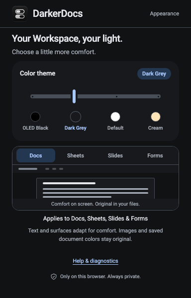

# DarkerDocs

A local-only Manifest V3 extension for Google Workspace in Helium. **Version 0.3.1** themes document pages, spreadsheet grids, application controls, Forms and the settings panel. Slides keep their original artwork.

## Install or update in Helium

1. Open **chrome://extensions** and enable **Developer mode**.
2. Choose **Load unpacked** and select the **extension** folder containing manifest.json.
3. Reload already-open supported Google Workspace tabs once.
4. Open **Extensions → DarkerDocs** to choose a theme.

For the installation ZIP, extract **artifacts/DarkerDocs-0.3.1.zip** into a permanent folder, then load the extracted folder containing manifest.json. Keep that folder in place. This is an unpacked development extension, not a marketplace package.

When updating an existing installation, choose **Reload** on DarkerDocs in the extension manager, then reload the Workspace tabs. Version 0.3.1 keeps the existing storage-only permission.

## Appearance

The slider order is **OLED Black → Dark Grey → Default → Cream**. First use selects Dark Grey. Drag the slider, click a label, or use the arrow keys, Home and End. Theme changes ease over roughly one second: backgrounds lead, popup text and page headings follow after 120 ms, and controls join after 240 ms. These stages overlap. Canvas content crossfades together to preserve its rendering. Selection updates immediately; reduced-motion preferences skip animation. The complete popup fits below Helium's 600 px height limit.

| Mode | Workspace | Document paper |
|---|---|---|
| OLED Black | True black | True black |
| Dark Grey | Deep charcoal | Dark charcoal |
| Default | Google's original appearance | Original |
| Cream | Warm amber | Warm ivory |

The popup includes illustrative Docs, Sheets, Slides and Forms previews. These previews do not change the shared setting. If a preference cannot be loaded or saved, use **Retry**. **Help & diagnostics** opens a local troubleshooting page.

The preference is stored only in this browser under **darkerdocs.settings.v1**, with the value **{ theme: "oled" / "dark" / "default" / "cream" }**. Supported open tabs update together. Default removes page transformations.

## Content and preservation

- **Docs:** themed workspace, paper and visible text, including colored text, tables and highlights.
- **Sheets:** themed grid, formula bar, headers, tabs and controls. Selection and scrolling remain native.
- **Slides:** themed workspace, filmstrip, speaker-notes area, toolbars and sidebars. Slides, presentation playback and artwork previews stay original.
- **Forms:** themed editor, Questions/Responses/Settings tabs, theme sidebar and respondent/preview controls. Color-picker swatches and images stay original.

Visible colors adapt for contrast. Chromatic text and paint retain their hue family; monochrome content can invert. Images retain their original pixel colors, including monochrome images and transparency. Text embedded inside an image is part of the image and is not recolored.

Docs and Sheets draw into their original canvases. DarkerDocs keeps a separate, pointer-transparent screen copy, preserving native canvas pixels, getters and serialization. It does not edit document formatting, content models or Google account preferences. Print media and supported output routes retain their original appearance; Sheets' in-app print view also stays original.

When a canvas cannot be safely replayed, its original surface is retained and identified. Ambiguous gradients and patterns are preservation fallbacks, not fully themed content. Expand the compact notice for the reason, or dismiss it. Rendering limits may recur after reloading; tabs never reload automatically.

Generated UI styles use at most 4,096 reusable color tokens. If this limit is reached, the complete page retains its original appearance until you explicitly select a theme to retry. Canvas history is bounded per surface and by a 96 MiB estimated retained-resource budget per page, including display bitmaps and temporary replay surfaces. These are accounting estimates, not measurements of the browser’s complete JavaScript/GPU memory. Default releases display-copy bitmaps.

Supported HTTPS paths are **docs.google.com/document/**, **/spreadsheets/**, **/presentation/** and **/forms/**, including account-specific homepages. Cross-origin embedded panels retain their native appearance.

## Privacy and implementation

Vanilla JavaScript, CSS and HTML; no runtime dependencies, telemetry, account sync, external font loads or extension network requests. The only API permission is **storage**, plus the four static Workspace content-script path patterns. There is no background service worker.

The original icon design is retained in **assets/DarkerDocs.png**. Optimized, transparent sRGB PNGs in **extension/assets/** provide the toolbar, extension-manager, popup and favicon sizes; the full-resolution source is excluded from the installation ZIP.

Roboto and its [SIL Open Font License](extension/assets/Roboto-OFL.txt) are bundled locally. DarkerDocs is independent of Google and Helium.

Open **Help & diagnostics** in the popup to see the selected theme and the appearance each responding page is showing, including original output views and preservation fallbacks. The page also reports fallback reasons and estimated renderer resources. **Copy diagnostics** copies a fixed set of fields from scoped content scripts and omits document text, URLs, tab titles and class names. If clipboard access is unavailable, the page selects the diagnostic text for manual copying.

## Develop and verify

The delivered extension folder is ready to load. Using the extension requires no Node, npm, Python or installed packages. Editing the vanilla JavaScript, CSS and HTML requires no npm modules. Building, packaging and release verification use only Python 3 and its standard library:

    python3 scripts/build.py
    python3 scripts/package.py
    python3 scripts/verify_release.py

Rebuild after editing shared/core.js or content/renderer.js; the generated renderer.bundle.js is the MAIN-world entry. Run the build before packaging. The `npm run build`, `npm run package` and `npm run verify:release` aliases remain available, but installing npm modules is unnecessary for these commands.

Node's built-in test runner needs no installed npm modules:

    node --test tests/*.test.cjs

Only browser tests and the synthetic performance benchmark need third-party npm modules. The sole direct dependency is pinned `@playwright/test`; its Playwright dependencies are also testing-only. Install these only when running those checks:

    npm ci --ignore-scripts --omit=optional
    npx --no-install playwright install chromium
    npm test
    npm run test:browser
    npm run benchmark

The install command disables package lifecycle scripts and omits optional dependencies (including the macOS file watcher). Chromium is explicitly installed for isolated testing. No formatter, bundler or other development/build npm package is required or installed.

Packaging is deterministic and allowlisted. It checks version consistency and the generated MAIN bundle, verifies each ZIP entry against source, and writes SHA-256 and per-file verification metadata. The GitHub Actions workflow builds, runs Node checks and verifies the package before installing any npm modules, then runs browser checks and the synthetic benchmark when this repository is hosted on GitHub.

Keep handwritten source formatting consistent manually; no formatter package is used. Automated tests use synthetic pages and isolated Chromium profiles; they never automate the signed-in Helium profile.

See the [test report](docs/TEST_REPORT.md) for automated checks, transition and icon-refresh validation, native Helium evidence, output PDFs, preservation fallbacks and remaining live-matrix gaps. Native 0.2.0 captures are under **artifacts/v0.2/**; synthetic regression screenshots are under **artifacts/screenshots/**. Screenshots, document links, PDFs and development dependencies are excluded from the installation ZIP.
